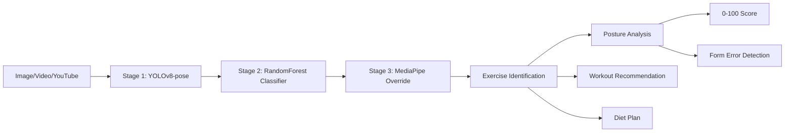
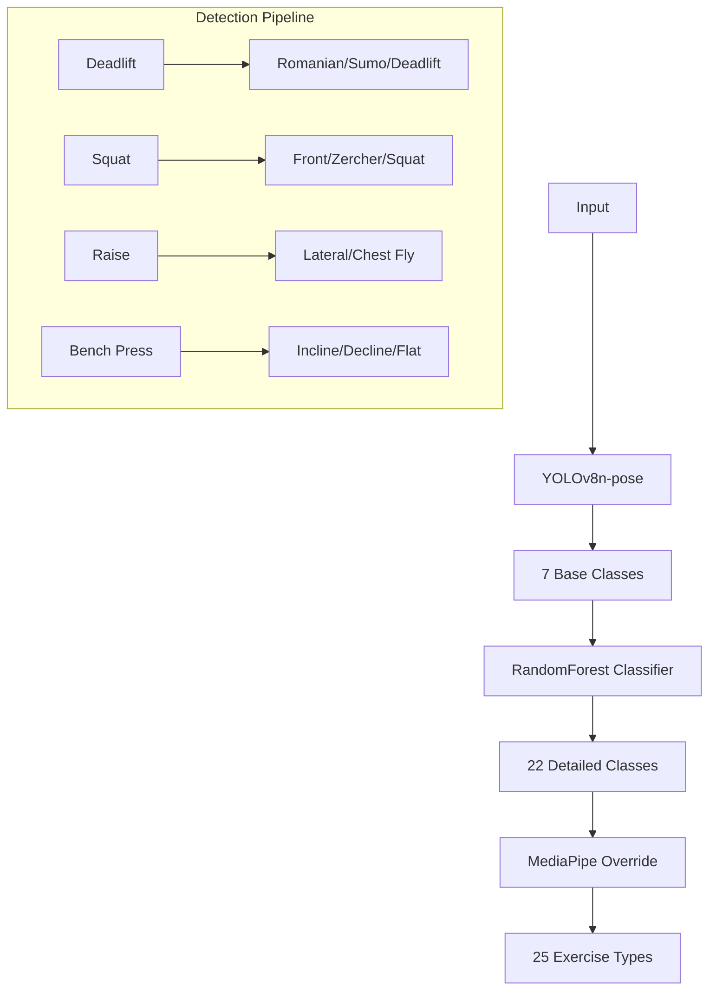
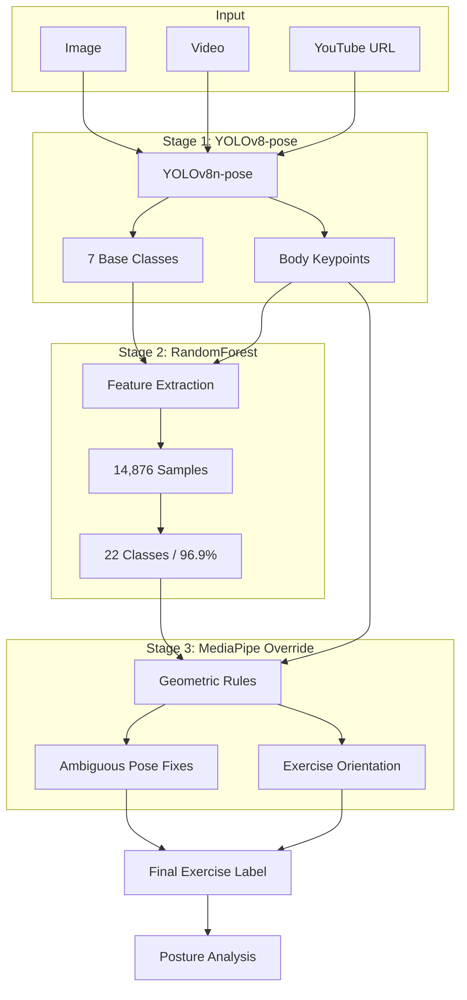

# 💪 AI Fitness Coach

<div align="center">


**AI-Powered Personal Fitness Coach with Exercise Detection & Posture Analysis**

[]()
[](https://github.com/samalarakshithbabu/ai-fitness-coach/issues)

</div>

---

## 🚀 Executive Summary

An end-to-end **AI fitness coaching system** that detects exercises from images and videos, analyzes posture in real-time using body keypoints, and delivers personalized workout and diet recommendations. Achieves **96.9% accuracy** using a 3-stage ML pipeline combining YOLOv8, Random Forest, and MediaPipe pose detection.

### What It Does



---

## 🎯 Problem Statement

| Challenge | Impact |
|-----------|--------|
| **Form Feedback** | Personal trainers are expensive and not always available |
| **Exercise Tracking** | Manual logging is tedious and inconsistent |
| **Progress Analysis** | No objective measurement of workout quality |
| **Personalization** | Generic plans don't account for individual needs |

**Our Solution:** An AI coach that provides real-time exercise detection, posture scoring, and personalized recommendations.

---

## ✨ Key Features

### 1. Exercise Detection (25 Classes)



| # | Exercise | # | Exercise |
|---|----------|---|----------|
| 0 | Deadlift | 13 | Lat Pulldown |
| 1 | Lateral Raise | 14 | Pull Up |
| 2 | Squat | 15 | Push Up |
| 3 | Front Squat | 16 | Leg Extension |
| 4 | Zercher Squat | 17 | Leg Raises |
| 5 | Romanian Deadlift | 18 | Hip Thrust |
| 6 | Sumo Deadlift | 19 | Plank |
| 7 | Bench Press | 20 | Tricep Dips |
| 8 | Incline Bench Press | 21 | Tricep Pushdown |
| 9 | Decline Bench Press | 22 | T-Bar Row |
| 10 | Barbell Biceps Curl | 23 | Russian Twist |
| 11 | Hammer Curl | 24 | Chest Fly Machine |
| 12 | Shoulder Press | | |

### 2. Posture Analysis

```
┌─────────────────────────────────────────────────────────────┐
│                    POSTURE SCORING ENGINE                    │
├─────────────────────────────────────────────────────────────┤
│                                                             │
│   Input: 33 Body Keypoints from MediaPipe                   │
│                                                             │
│   Analysis:                                                 │
│   • Joint angle calculations                                │
│   • Alignment checks                                        │
│   • Range of motion verification                            │
│   • Exercise-specific rules (25 sets)                       │
│                                                             │
│   Output:                                                   │
│   • Overall Score (0-100)                                   │
│   • Specific form errors identified                         │
│   • Improvement recommendations                             │
│                                                             │
└─────────────────────────────────────────────────────────────┘
```

### 3. Video & YouTube Analysis

- **Video Upload** - Analyze exercise videos frame-by-frame
- **YouTube Integration** - Paste any YouTube URL for analysis
- **Confidence Voting** - Multiple frames, majority vote
- **20-30 Frames** - Sampled for robust detection

### 4. Personalized Recommendations

| Feature | Description |
|---------|-------------|
| **Workout Plans** | BMI-aware exercises by goal |
| **Diet Plans** | Calorie targets with meal suggestions |
| **Goal Options** | Fat loss, muscle gain, endurance |
| **Difficulty Levels** | Beginner, intermediate, advanced |

---

## 🧠 ML Pipeline Architecture



### Model Performance

| Model | Classes | Accuracy | Notes |
|-------|---------|----------|-------|
| **YOLOv8n-pose** | 7 | Trained | Deadlift, squat variants, lateral raise |
| **RandomForest** | 22 | 96.9% | 14,876 samples, 5-fold stratified CV |
| **MediaPipe Rules** | 25 | Heuristic | Geometric overrides |

---

## 🛠️ Technology Stack

### Backend

| Technology | Purpose | Version |
|------------|---------|---------|
| **FastAPI** | Web framework | 0.109+ |
| **Python** | Core language | 3.12+ |
| **Ultralytics YOLOv8** | Pose detection | Latest |
| **MediaPipe Tasks** | Pose estimation | Latest |
| **scikit-learn** | Random Forest | Latest |
| **OpenCV** | Computer vision | Latest |
| **yt-dlp** | YouTube downloads | Latest |
| **pyttsx3** | Text-to-speech | Latest |

### Frontend

| Technology | Purpose | Version |
|------------|---------|---------|
| **React** | UI framework | 18+ |
| **Tailwind CSS** | Styling | 3.4+ |
| **React Router** | Navigation | 6+ |
| **Recharts** | Charts/Dashboard | Latest |

### Database

| Technology | Purpose |
|------------|---------|
| **SQLite** | Session history |

---

## 📁 Project Structure

```
ai-fitness-coach/
├── 📱 fitness-coach-ui/           # React + Tailwind frontend
│   ├── src/
│   │   ├── pages/
│   │   │   ├── Home.jsx          # Landing page
│   │   │   ├── Dashboard.jsx     # Live stats + charts
│   │   │   ├── Workout.jsx       # Detection UI + YouTube
│   │   │   ├── Diet.jsx          # Diet plan generator
│   │   │   └── Exercises.jsx     # Exercise library
│   │   └── components/
│   └── package.json
│
├── 🌐 frontend/                   # Vanilla JS lightweight UI
│   ├── index.html
│   ├── style.css
│   └── app.js
│
├── ⚙️ backend/                    # FastAPI backend
│   └── main.py                    # All 9 API endpoints
│
├── 🤖 models/
│   ├── fitness_pose/
│   │   └── weights/best.pt       # YOLOv8n-pose (19 MB)
│   ├── pose_landmarker_lite.task # MediaPipe (5.5 MB)
│   └── fitness.yaml              # YOLO dataset config
│
└── 🛠️ utils/
    ├── classifier.py             # RF classifier
    ├── posture_analyzer.py       # 25 exercise rule sets
    ├── retrain_classifier_fast.py# Classifier training
    ├── recommendation_engine.py  # Workout/diet plans
    ├── voice_feedback.py         # TTS feedback
    └── test_project.py           # Integration tests
```

---

## 📋 API Endpoints

| Method | Endpoint | Description |
|--------|----------|-------------|
| POST | `/upload-image` | Full pipeline: YOLO + classifier + posture |
| POST | `/upload-video` | Video frame sampling + majority vote |
| POST | `/predict-image` | Same as upload-image |
| POST | `/predict-video` | Video or YouTube URL analysis |
| POST | `/detect-exercise` | YOLO detection only |
| POST | `/get-recommendation` | BMI-aware workout plan |
| GET | `/history` | Past sessions from SQLite |
| GET | `/report` | Last session summary |
| GET | `/health` | Server status check |
| GET | `/docs` | Swagger UI |

---

## 🛠️ Installation

### Prerequisites

- Python 3.12+
- Node.js 18+
- pip / npm
- Git

### 1. Clone Repository

```bash
git clone https://github.com/samalarakshithbabu/ai-fitness-coach.git
cd ai-fitness-coach
```

### 2. Backend Setup

```bash
# Create virtual environment
python -m venv venv
venv\Scripts\activate  # Windows
# or: source venv/bin/activate  # Linux/Mac

# Install dependencies
pip install -r requirements.txt
```

### 3. Frontend Setup

```bash
# React UI
cd fitness-coach-ui
npm install
npm start
```

### 4. Model Setup (Required)

```bash
# Train classifier (requires dataset)
python utils/retrain_classifier_fast.py

# Or use pre-trained models (if available)
# Place models/exercise_classifier.pkl
```

---

## 🚀 Running the Application

### Start Backend

```bash
uvicorn backend.main:app --reload --port 8000
```

### Access Interfaces

| Interface | URL |
|-----------|-----|
| **React UI** | http://localhost:3000 |
| **Vanilla JS UI** | http://localhost:8000/static/index.html |
| **API Docs** | http://localhost:8000/docs |

---

## 📖 Usage Guide

### 1. Upload Image for Analysis

```python
import requests

response = requests.post(
    "http://localhost:8000/predict-image",
    files={"file": open("squat.jpg", "rb")}
)
print(response.json())
```

### 2. Analyze YouTube Video

```python
response = requests.post(
    "http://localhost:8000/predict-video",
    json={"url": "https://youtube.com/watch?v=..."}
)
print(response.json())
```

### 3. Get Workout Recommendation

```python
response = requests.post(
    "http://localhost:8000/get-recommendation",
    json={
        "height_cm": 175,
        "weight_kg": 70,
        "goal": "muscle_gain",
        "level": "intermediate"
    }
)
print(response.json())
```

---

## 🔮 Future Improvements

- [ ] Real-time camera feed analysis
- [ ] Mobile app (React Native)
- [ ] Additional exercises (50+ classes)
- [ ] 3D pose estimation
- [ ] Social features and challenges
- [ ] Integration with wearables

---

## 📄 License

This project is licensed under the MIT License.

---

## 👨‍💻 Author

**SAMALA RAKSHITH BABU**

- 📧 Email: samalarakshithbabu7@gmail.com
- 💼 LinkedIn: [samala-rakshith-babu](https://www.linkedin.com/in/samala-rakshith-babu/)
- 🐙 GitHub: [samalarakshithbabu](https://github.com/samalarakshithbabu)

---

<div align="center">

**Built with ❤️ for Fitness Enthusiasts**

</div>